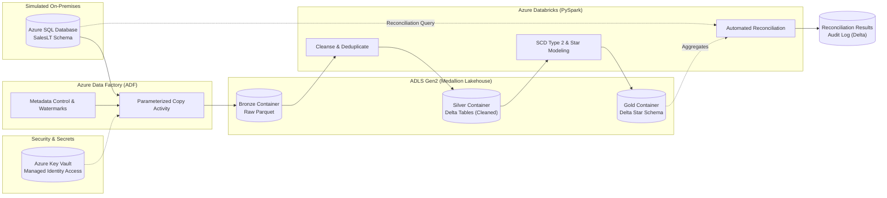

# Legacy-to-Cloud Migration with Automated Reconciliation

[](https://azure.microsoft.com/en-us/products/data-factory)
[-red)](https://azure.microsoft.com/en-us/products/databricks)
[](https://delta.io/)
[](https://azure.microsoft.com/en-us/products/storage/data-lake-storage)

---

## 📌 Executive Summary & Client Context

* **Client Problem**: A national retail chain manages critical business reporting through an on-premises legacy SQL Server data warehouse. Long-running analytical queries frequently lock operational tables, licensing and physical server maintenance are cost-prohibitive, and scalability has reached its limit.
* **Modernisation Objective**: Migrate all analytical workloads and history to a scalable, cost-efficient Lakehouse architecture on Microsoft Azure.
* **Core Requirement**: Ensure **zero data loss** and complete auditability. Every ingested and transformed record must be programmatically reconciled against the source database across counts, numeric aggregations, and null distributions.

---

## 🏗️ Architecture & Data Flow



---

## 🧰 Tech Stack & Component Mapping

| Category | Component | Purpose in Architecture |
|---|---|---|
| **Source System** | Azure SQL Database (`adventureworkslt-db`) | Simulates the legacy on-premises warehouse using the AdventureWorksLT retail dataset. |
| **Orchestration** | Azure Data Factory (`adf-retail-dev-rg`) | Metadata-driven pipeline coordinator managing data copies, parameter passing, and job dependencies. |
| **Data Lake** | ADLS Gen2 (`stretaildevrg`) | Hierarchical namespace storage partitioned into `bronze`, `silver`, and `gold` containers. |
| **Compute & Transforms**| Azure Databricks (`dbw-retail-dev`) | PySpark execution engine applying business logic, schema enforcement, Delta MERGE, and SCD Type 2 modeling. |
| **Secret Management** | Azure Key Vault (`kv-retail-dev-rg`) | Centralized secret store evaluated via Azure RBAC and Managed Identities to avoid plaintext passwords. |
| **CI / CD** | GitHub & GitHub Actions | Source control, automated linting, test suites, and parameterized pipeline deployment. |

---

## 📂 Repository Structure

```text
retail-lakehouse-migration/
├── .gitignore                         # Strict exclusion for secrets, logs, and environments
├── README.md                          # High-level architecture and implementation runbook
├── config/
│   └── settings.example.json          # Template of environment variables and identifiers
├── sql/
│   ├── watermark/                     # Watermark definition and update stored procedures
│   └── logging/                       # Execution and pipeline audit logging DDL
├── adf/                               # Azure Data Factory pipeline and dataset definitions
├── databricks/
│   └── notebooks/                     # PySpark transformation and reconciliation notebooks
├── tests/                             # Data quality test scripts and validation checks
├── docs/                              # Design decisions, trade-offs, and operational runbook
└── .github/
    └── workflows/                     # Continuous Integration and deployment automation
```

---

## 📊 Run Metrics & Reconciliation Results

> *Metrics will be populated from live validation runs during pipeline execution.*

| Metric Category | Source (SQL DB) | Target (Gold Lakehouse) | Match Status | Notes |
|---|---|---|---|---|
| Customer Record Count | `TO FILL FROM MY RUN` | `TO FILL FROM MY RUN` | `TO FILL` | Total dimension entities |
| Product Record Count | `TO FILL FROM MY RUN` | `TO FILL FROM MY RUN` | `TO FILL` | Categorised merchandise rows |
| Sales Order Total Revenue | `TO FILL FROM MY RUN` | `TO FILL FROM MY RUN` | `TO FILL` | Checksum on LineTotal aggregates |
| Overall Integrity Verdict | — | — | `PENDING EXECUTION` | Complete source-to-target alignment |
